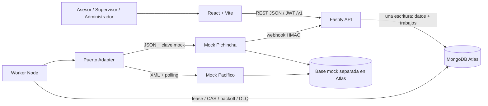

# Arquitectura y patrones · RA2

La solución es un monolito modular TypeScript con procesos API y worker separados, una web React y un servidor mock independiente. MongoDB conserva solicitudes y trabajos embebidos: crear una solicitud y sus trabajos es una sola escritura atómica. Esto evita agregar Redis o una transacción entre cola y base para el MVP.

La web y el backend son componentes independientes dentro de un monorepo. La ruta vigente utiliza frontend estático en Azure, API/worker/mocks en EC2 Ubuntu con Node.js directamente y persistencia en Atlas. El término monolito modular se refiere al backend, no a un despliegue único de web y servidor.

## Estilo y componentes

| Alternativa             | Ventaja para el caso                                                       | Costo/limitación                                                   | Decisión                                         |
| ----------------------- | -------------------------------------------------------------------------- | ------------------------------------------------------------------ | ------------------------------------------------ |
| REST + OpenAPI          | HTTP directo desde navegador, recursos, herramientas de contrato y Swagger | Varias llamadas para vistas complejas                              | Seleccionado; complejidad proporcionada al flujo |
| GraphQL                 | Consultas de campos flexibles y agregación                                 | Autorización por campo, límites de consulta y caché más complejos  | No se necesita con una web y pocos recursos      |
| gRPC                    | Contrato tipado binario y streaming interno                                | Navegador requiere infraestructura adicional; no hay malla interna | Descartado para este MVP                         |
| Procesamiento asíncrono | Aísla latencia/fallo del proveedor                                         | Consistencia eventual y recuperación de trabajos                   | Complementa REST para integraciones              |

La comparación evalúa la simulación actual; no afirma qué tecnologías usan bancos reales. La API responde 202 después de persistir y el worker realiza la llamada externa.



La conexión y un flujo funcional con Atlas se verificaron desde la computadora de desarrollo el 22 de octubre de 2026. Los despliegues de los procesos en AWS y de la web en Azure requieren sus propias comprobaciones. Consulte [ATLAS](ATLAS.md) y la [guía de despliegue](DEPLOYMENT.md).

## Flujo asíncrono

```mermaid
sequenceDiagram
  actor Asesor
  participant Web
  participant API
  participant Mongo
  participant Worker
  participant Mock
  Asesor->>Web: Registra consentimiento y financieras
  Web->>API: POST /v1/solicitudes + Idempotency-Key
  API->>Mongo: insert atómico solicitud + jobs
  API-->>Web: 202 + Location + ETag
  Worker->>Mongo: Reclama job pendiente / lease vencido
  Mongo-->>Worker: Lease con token exclusivo
  Worker->>Mock: Modelo traducido + clave estable
  alt fallo temporal
    Worker->>Mongo: Reprogramar backoff; dead al agotar
  else recibido
    Mock-->>Worker: Trámite externo
    Worker->>Mongo: Guardar trámite y programar poll
    alt Pichincha
      Mock->>API: Webhook firmado con eventId
      API->>Mongo: Validación + CAS + deduplicación
    else Pacífico / respaldo Pichincha
      Worker->>Mock: Consultar estado
      Mock-->>Worker: Resultado canónico o pendiente
      Worker->>Mongo: CAS + deduplicación
    end
  end
  Web->>API: GET detalle periódico
  API-->>Web: Estado y ofertas
```

Aceptar o desistir actualiza estado, versión, bitácora y trabajos de notificación en la misma solicitud. El worker informa `accepted` a la elegida y `withdrawn` a las demás, con recepción idempotente en los mocks. La entrega es al menos una vez: perder un lease puede repetir una llamada externa; las claves estables y deduplicación reducen efectos repetidos, sin prometer exactly-once.

## Patrones implementados y límites

| Patrón                        | Ubicación / problema resuelto                               | Límite                                                                                                                       |
| ----------------------------- | ----------------------------------------------------------- | ---------------------------------------------------------------------------------------------------------------------------- |
| Adapter / ACL                 | `backend/src/adapters.ts`; traduce canónico a JSON/XML      | Agregar banco también requiere enum, registro/configuración y pruebas                                                        |
| Async Request-Reply           | POST 202, `worker.ts`, jobs en Mongo                        | UI consulta; no push al navegador                                                                                            |
| Cola duradera embebida        | Insert atómico, dueAt, lease token, reclamo CAS             | Un job activo por banco/solicitud; auditoría crece en documento                                                              |
| Retry + DLQ                   | Backoff exponencial, intentos y `dead`                      | Reactivación admin es una operación separada; no broker dedicado                                                             |
| Circuit Breaker               | `circuits`, apertura después de 3 fallos consecutivos       | Aproximación simple compartida; no máquina half-open estricta                                                                |
| Timeouts                      | `AbortSignal.timeout` en adaptadores                        | Cancelar cliente no revierte efectos ya recibidos por mock                                                                   |
| Idempotencia                  | Índice owner/key y fingerprint canónico; claves de acciones | Mismo recurso sin duplicar efectos; replay entrega su estado actual, no una copia inmutable de la primera respuesta; sin TTL |
| Bloqueo optimista             | version, ETag / If-Match y CAS                              | Cliente debe refrescar con 412; colisiones pueden exigir reintento                                                           |
| Deduplicación                 | `eventId` por financiera y cierre terminal                  | No impide que un administrador DB altere historial                                                                           |
| Paginación/filtros/orden      | Lista page/size/state/bank/sort                             | Offset no es óptimo en páginas muy profundas                                                                                 |
| Autorización por agencia      | Filtro de lectura y roles del servicio                      | No aprobación por montos ni rol analista                                                                                     |
| Rate limiting                 | Fastify por usuario/IP y login                              | Contadores por proceso, no globales entre réplicas                                                                           |
| Problem Details y correlación | Error handler y X-Correlation-ID                            | Sin plataforma de alertas ni trazas distribuidas                                                                             |

API Gateway separado, BFF, microservicios, Kubernetes, service registry y CQRS con otra base no aportan valor suficiente para este tamaño. Fastify agrupa validación/autenticación/límites del punto de entrada. Un borde HTTPS futuro deberá resolver TLS y controles distribuidos según el ambiente seleccionado.

## Incorporar una financiera

Defina contrato mock independiente, implemente `Adapter.submit/poll/notify`, agregue banco y registro, actualice enum/esquemas compatibles de OpenAPI y tipos, y pruebe mapeos, timeout, duplicados, recuperación y decisiones. No exponga formatos del proveedor en el modelo público. Si se requiere incorporación sin cambio de código, RF-17/RNF-15 requieren un diseño adicional de configuración y plugins, hoy pendiente.

Decisiones: [ADR-001](adr/001-estilo-y-componentes.md), [ADR-002](adr/002-mongo-y-cola.md), [ADR-003](adr/003-seguridad-y-simulacion.md). Modelo: [DATA_MODEL](DATA_MODEL.md).
