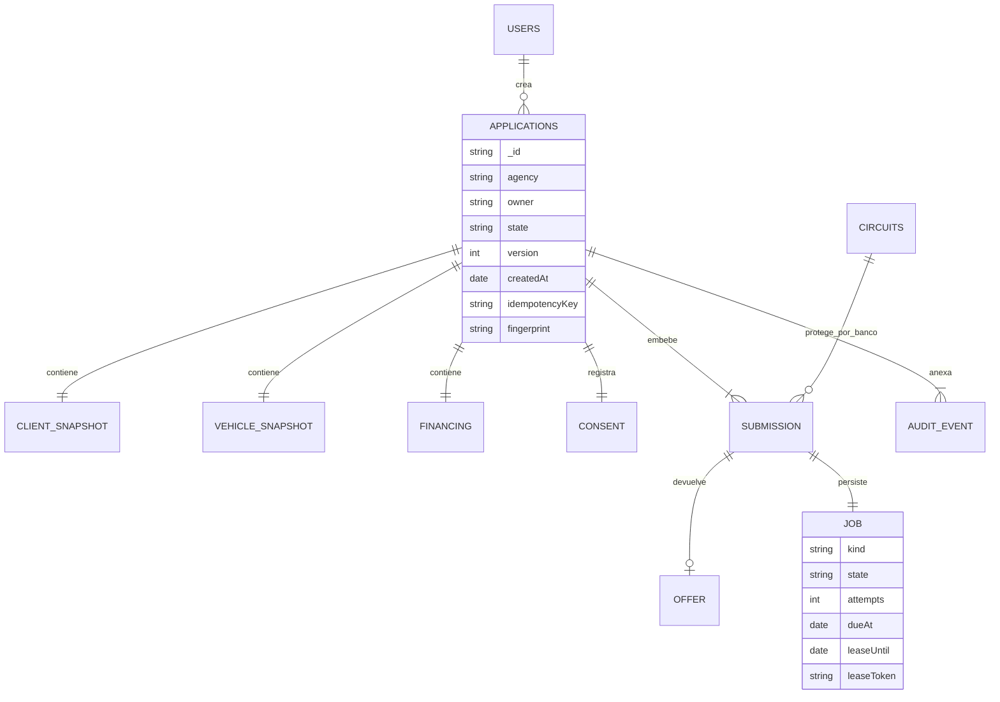

# Modelo de datos · RA3

MongoDB utiliza un agregado `applications` por solicitud. Cliente ficticio, vehículo, financiamiento, consentimiento, ofertas, estado por banco, trabajos y bitácora quedan embebidos porque se leen juntos y deben cambiar de manera atómica. `users` y `circuits` son colecciones separadas por identidad y ciclo de vida. El servicio mock conserva sus propios `submissions` en otra base; no lee documentos internos de la API.

Los nodos embebidos del diagrama no son colecciones adicionales. `owner` refiere al identificador de usuario como valor; no hay claves foráneas de Mongo. La instantánea de cliente y vehículo mantiene el contexto de la solicitud, sin una fuente maestra CRM.

| Campo o agregado     | Decisión                                                                |
| -------------------- | ----------------------------------------------------------------------- |
| `_id`                | UUID interno string, diferente del trámite `externalId` por financiera  |
| Dinero               | Enteros `*Cents` en centavos USD; convertir solo para mostrar           |
| Fechas               | BSON Date en persistencia; representación pública ISO 8601              |
| `consent/consentAt`  | Aceptación, canal, evidencia textual y fecha del servidor               |
| `submissions.<bank>` | Estado, trámite, oferta opcional, eventIds aplicados y job              |
| `job`                | submit/poll/notify; pending/leased/done/dead; dueAt, leaseUntil y token |
| `actions`            | Hash por actor/clave para replay de aceptación/desistimiento            |
| `audit`              | Fecha, actor, acción, correlation ID; anexada por aplicación            |
| `users`              | Email único, rol/agencia e identidad; hash scrypt con salt aleatorio    |
| `circuits`           | Identificador banco, fallos y fecha hasta la que permanece abierto      |

## Índices y validaciones

`backend/src/store.ts` crea índices únicos `(owner,idempotencyKey)` y `users.email`; índices `(agency,createdAt,_id)`, `(state,createdAt)` y `(job.state,job.dueAt)` por banco. El mock usa índice único `(bank,input.applicationId)` y `(callbackDone,callbackDue)`. El índice de `state` no elimina el costo de consultas con múltiples filtros; se debe observar `explain` antes de añadir índices para otro volumen.

OpenAPI/Fastify valida el JSON público y el servicio aplica consentimiento, entrada mínima y plazos. El acceso directo a Mongo no queda protegido por esas validaciones de aplicación. No existen validadores de colección equivalentes a todo el contrato; agregarlos es una defensa adicional pendiente.

## Atomicidad y consistencia

Crear la solicitud con jobs evita el hueco entre guardar datos y publicar una tarea. CAS por `version` evita sobrescribir respuestas concurrentes y aceptación/desistimiento. Un lease con token identifica al dueño del trabajo; solo ese token puede confirmar el resultado. Un lease vencido permite recuperación después de detener/reiniciar worker. Los intentos y su vencimiento se conservan en Mongo.

No se requieren transacciones multidocumento para el flujo de solicitud actual: sus invariantes principales están dentro de un documento. La actualización del circuito separado y la llamada HTTP al mock no forman parte de esa atomicidad. La entrega externa es al menos una vez y la vista converge con webhook/polling. El mock también deduplica el trámite y la decisión.

## Ciclo de vida y límites

Solicitud: `ENVIADA → OFERTAS / SIN_OFERTAS → ACEPTADA / DESISTIDA`. Puede desistirse mientras está abierta; oferta aceptada y desistida son terminales. Por banco: PENDIENTE → EN_ANALISIS → APROBADA/CONDICIONES/RECHAZADA/INFORMACION; ERROR representa integración agotada. No existen BORRADOR, FORMALIZADA ni EXPIRADA implementados.

`audit`, `events` y `actions` pueden crecer: el límite de documento MongoDB requiere retención/archivo para escala prolongada. No hay respaldo, prueba de restauración, borrado del titular ni inmutabilidad contra DB admin. Un volumen Docker es persistencia local, no una estrategia RPO/RTO. Ver [BACKLOG](BACKLOG.md).
